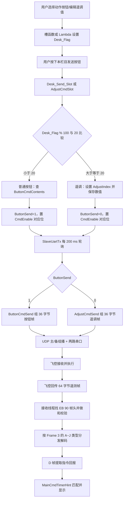

# 遥控按钮、遥调数据、组帧发送与遥测解帧技术说明

## 1. 文档范围与核心结论

本文以“刹车普通按钮”“侧偏遥调”和“地效遥调”为例，说明本程序中一条命令从界面产生、分类、暂存、组帧、发送，到接收飞控回报并解帧显示的完整过程。

先明确两个容易混淆的概念：

- **遥控指令（按钮指令）**：用户选中一个离散动作，例如“刹车某模式”。程序从 `ButtonCmdContents` 查出一个单字节命令码，并在上行帧中重复发送 5 次。
- **遥调指令（数值指令）**：用户输入一个连续量或选择一种数据源，例如侧偏、空速、舵偏、地效参数。程序使用 `AdjustIndex` 标识参数种类，并将数值按协议缩放、转为字节后装入上行帧。

还要注意：

> 本程序发送的是 **36 字节上行控制帧**；本工程现有的 `Tele_Rx.cpp` 解析的是飞控回传的 **64 字节下行遥测帧**。二者是两个方向的协议，并不是同一个帧格式的编码与反编码。36 字节控制帧在飞控侧如何解码，需要查看飞控机程序，本仓库没有这一部分源码。

整个流程也并非全部位于 Qt 槽函数中：

- Qt 槽函数或 Lambda：响应界面事件、产生 `Desk_Flag`、采集数值并写入全局待发送结构体 `Cmd`。
- Windows 工作线程 `SlaveUartTx()`：每 200 ms 检查一次 `Cmd` 是否有待发送数据。
- 普通函数 `ButtonCmdSend()` / `AdjustCmdSend()`：组装 36 字节帧、计算校验、通过 UDP 和串口发送。
- 接收线程 `SlaveUDPRx()` / `UartRx()`：搜索 64 字节遥测帧、校验并调用各帧解码函数。
- Qt 定时刷新函数 `MainCmdTimerHint()`：读取已经解出的回报字段并显示到界面。

相关源码：

- [`PgmWnd/PgmWndDesk.cpp`](PgmWnd/PgmWndDesk.cpp)：主界面按钮绑定、类别编码、主界面遥调和指令回报显示。
- [`PgmWnd/PgmWndAdjustCmd.cpp`](PgmWnd/PgmWndAdjustCmd.cpp)：独立遥调窗口及数值处理。
- [`Tele/Tele_Tx.cpp`](Tele/Tele_Tx.cpp)：36 字节上行帧组装和发送。
- [`Tele/Tele_Rx.cpp`](Tele/Tele_Rx.cpp)：64 字节下行遥测帧查找、校验和解码。
- [`PgmWndMain.h`](PgmWndMain.h)：公共类型、协议常量和 `CmdStruc` 定义。
- [`PgmWndMain.cpp`](PgmWndMain.cpp)：普通按钮命令码表和通信全局变量定义。

## 2. 总体调用链



## 3. 核心变量及其含义

### 3.1 `CmdStruc`：界面线程与发送线程之间的“发件箱”

`CmdStruc` 定义在 `PgmWndMain.h`，全局实例 `Cmd` 定义在 `PgmWndMain.cpp`。

```cpp
typedef struct CmdStruc
{
    u16 CmdEnable;
    u8  RxCmdBackEnable;
    u8  RxAdjustBackEnable;

    u8  ButtonCmdMatter[15];
    u8  ButtonSend;

    u8  AdjustIndex;
    u8  AdjustEnable;
    double AdjustCmdMatter[15][5];
} CmdStruc;
```

| 变量                          | 作用               | 当前程序中的使用方式                                                 |
| --------------------------- | ---------------- | ---------------------------------------------------------- |
| `Cmd.CmdEnable`             | 待发送栏目位图          | 第 `n` 位为 1，表示第 `n` 个栏目有待发送命令。比如刹车栏目为 bit 1，通用遥调/地效为 bit 13 |
| `Cmd.RxCmdBackEnable`       | 等待普通按钮回报标志       | `ButtonCmdSend()` 发送后设为 1，成功匹配回报后清零                        |
| `Cmd.RxAdjustBackEnable`    | 等待遥调回报标志         | `AdjustCmdSend()` 发送后设为 1，成功匹配回报后清零                        |
| `Cmd.ButtonCmdMatter[n]`    | 第 `n` 栏目的普通按钮命令码 | 例如刹车第一个按钮查表得到 `0x36`，存入 `[1]`                              |
| `Cmd.ButtonSend`            | 命令类别             | `1` 表示普通按钮遥控；`0` 表示数值遥调                                    |
| `Cmd.AdjustIndex`           | 遥调参数序号           | 例如侧偏为 5、空速为 4、地效为 28                                       |
| `Cmd.AdjustEnable`          | 预留遥调标志           | 当前代码中没有形成有效控制逻辑                                            |
| `Cmd.AdjustCmdMatter[n][m]` | 遥调数值暂存区          | 当前绝大多数命令只使用 `[栏目][0]`                                      |

### 3.2 其他关键全局变量

| 变量                           | 类型          | 注释                            |
| ---------------------------- | ----------- | ----------------------------- |
| `Desk_Flag`                  | `int`       | 当前界面操作的统一编码，初始值为 `-1`         |
| `ButtonCmdContents[15][20]`  | `u8` 二维数组   | 普通按钮到飞控协议命令码的查找表              |
| `echo_tele_Cnt`              | `u8`        | 普通按钮帧的发送序号，初始为 1，发送一次后自增      |
| `GDdata[8]`                  | `double[8]` | 地效遥调的 8 个原始通道，发送时逐个强制转换成 1 字节 |
| `ActorFaultFlag[4]`          | `int[4]`    | 地效模式/故障选择标志                   |
| `PCU_State`                  | `int`       | PCU 控制状态码                     |
| `CmdBuf[36]`                 | `BYTE[36]`  | `Tele_Tx.cpp` 内部静态上行组帧缓存      |
| `UartCom`                    | `ComStruct` | 主串口配置和端口号                     |
| `UartSlaveCom`               | `ComStruct` | 备用串口配置和端口号                    |
| `MainCmd_SysState.echo_tele` | `u8`        | 从 D 帧解出的飞控回显序号/遥调序号           |
| `MainCmd_SysState.cmd_back`  | `u8`        | 从 D 帧解出的回报命令码                 |

### 3.3 `Desk_Flag` 的编码规则

主界面把“栏目”和“栏目内动作”压缩到一个整数中：

```text
Desk_Flag = 栏目号 × 100 + 栏目内动作号

栏目号       = Desk_Flag / 100
动作号或类型 = Desk_Flag % 100
```

示例：

| `Desk_Flag` | 含义 | `/100` | `%100` |
|---:|---|---:|---:|
| `100` | 刹车栏目第 0 个普通按钮 | 1 | 0 |
| `209` | 起降栏目的一键起飞特殊按钮 | 2 | 9 |
| `520` | 航线栏目“点号遥调” | 5 | 20 |
| `620` | 信息栏目“姿态信息源遥调” | 6 | 20 |
| `1321` | 通用遥调窗口“侧偏遥调” | 13 | 21 |
| `1336` | 通用遥调窗口“油门遥调” | 13 | 36 |
| `1320` | 地效遥调 | 13 | 20 |

主界面 `Desk_Send_Slot()` 使用下面的规则判断类别：

```cpp
if (Desk_Flag % 100 < Cmd_AmountButton) {
    // 普通按钮，Cmd_AmountButton == 20
} else {
    // 遥调数据
}
```

因此当前设计中，余数 `0~19` 是普通按钮，余数 `20` 及以上是遥调。

## 4. Qt 事件如何进入控制逻辑

### 4.1 动作选择按钮

每一栏使用一个 `QButtonGroup`。初始化时给按钮分配组内 ID，再把 `buttonPressed(int)` 连接到相应槽函数。例如：

```cpp
Break_Group->addButton(Break_Box[i], i);
connect(Break_Group, SIGNAL(buttonPressed(int)),
        this, SLOT(Break_Slot(int)));
```

用户按下刹车栏第 0 个按钮时：

```cpp
void PgmWndDesk::Break_Slot(int Break_ID)
{
    // Break_ID == 0 时，Desk_Flag 被设置为 100
}
```

这一步只是在内存中记录“用户选了什么”，并没有立即组帧。

### 4.2 编辑框与 Lambda

数值遥调常用 Lambda 直接记录操作类型：

```cpp
connect(ui->Adjust_1, &QLineEdit::editingFinished,
        [=]() mutable { Desk_Flag = 1321; });
```

这个 Lambda 是写在 `AdjustCmdInitial()` 内部的匿名函数，没有单独的函数定义。其作用只是：当侧偏编辑框结束编辑时，把全局 `Desk_Flag` 设为 `1321`。

地效快捷按钮 Lambda 定义在 `PgmWndDesk::Desk_Ini_Button()` 内部：

```cpp
connect(basicButtons[btnIdx], &QPushButton::clicked,
        this, [this, btnIdx]() {
    // 清空 ActorFaultFlag
    // 根据 btnIdx 设置地效数值或模式标志
});
```

### 4.3 栏目“发送”按钮

主界面所有发送按钮也被加入一个 `Send_Group`：

| 发送按钮 | `Send_ID` | 对应 `CmdEnable` 位 |
|---|---:|---:|
| `Run_Send` | 99 | bit 0 |
| `Break_Send` | 199 | bit 1 |
| `TakeoffandLand_Send` | 299 | bit 2 |
| `Route_Send` | 599 | bit 5 |
| `PreFlight_Send` | 1199 | bit 11 |
| `PCU_Send` | 1299 | bit 12 |
| `GD_Send` | 1399 | bit 13 |

连接关系为：

```cpp
connect(Send_Group, SIGNAL(buttonPressed(int)),
        this, SLOT(Desk_Send_Slot(int)));
```

`Send_ID / 100` 决定哪个栏目进入待发送状态；`Desk_Flag` 决定具体发送内容。二者职责不同。

这里意思是说，Desk_Flag决定我需要发的数据为地效数据（1，2，3倍数）。而send_ID为我的实际哪个按键的发送。
## 5. 普通按钮指令完整示例：刹车栏第 0 个按钮

### 5.1 第一步：选择按钮

假设用户按下 `Break_0`：

```text
Break_0 pressed
  -> Break_Slot(0)
  -> Desk_Flag = 100
```

其中：

```text
cardIndex  = 100 / 100 = 1     // 刹车栏目
actionIndex = 100 % 100 = 0    // 第 0 个动作
```

### 5.2 第二步：按下刹车栏发送按钮

`Break_Send` 在 `Send_Group` 中的 ID 为 `199`，所以触发：

```cpp
Desk_Send_Slot(199);
```

类别判断：

```text
Desk_Flag % 100 = 0
0 < Cmd_AmountButton(20)
=> 这是普通按钮指令
```

程序随后执行：

```cpp
const int cardIndex   = Desk_Flag / 100; // 1
const int actionIndex = Desk_Flag % 100; // 0

Cmd.ButtonCmdMatter[cardIndex]
    = ButtonCmdContents[cardIndex][actionIndex];
// ButtonCmdContents[1][0] == 0x36

Cmd.ButtonSend = 1;
Cmd.CmdEnable |= 1 << (199 / 100);
// 199 / 100 == 1，所以 CmdEnable 的 bit 1 被置位，即 0x0002
```

此时发件箱关键状态为：

```text
Desk_Flag               = 100
Cmd.ButtonSend           = 1
Cmd.ButtonCmdMatter[1]   = 0x36
Cmd.CmdEnable            = 0x0002
```

### 5.3 第三步：发送线程取出命令

`SlaveUartTx()` 每 200 ms 执行一次：

```cpp
if (Cmd.CmdEnable != 0) {
    if (Cmd.ButtonSend && Cmd.ButtonCmdMatter[card]) {
        ButtonCmdSend(&Cmd);
    } else if (Cmd.ButtonSend == 0) {
        AdjustCmdSend(&Cmd);
    }
} else {
    NULLCmdSend();
}
```

当前代码通过下面的公式从位图反推栏目号：

```cpp
card = int(log(Cmd.CmdEnable) / log(2) + 0.5);
```

当 `CmdEnable == 0x0002` 且只有一个 bit 为 1 时，结果为 1。

### 5.4 第四步：`ButtonCmdSend()` 组装 36 字节帧

`CmdSupply()` 先清零整个 `CmdBuf`，再填写固定头部：

```cpp
CmdBuf[0] = 0xEB;
CmdBuf[1] = 0x90;
CmdBuf[2] = 'A';   // 0x41
CmdBuf[3] = 'A';   // 0x41
CmdBuf[4] = 0xCC;  // 有效控制帧标志
```

按钮命令码 `0x36` 被重复填入 5 个位置：

```cpp
CmdBuf[5] = CmdBuf[6] = CmdBuf[7]
          = CmdBuf[8] = CmdBuf[9] = 0x36;
```

帧序号放在第 34 字节：

```cpp
CmdBuf[34] = echo_tele_Cnt++;
```

若本次 `echo_tele_Cnt == 1`，则实际帧内容为：

```text
偏移  00 01 02 03 04 05 06 07 08 09 10 ... 33 34 35
数据  EB 90 41 41 CC 36 36 36 36 36 00 ... 00 01 28
```

最后一个 `0x28` 是按当前示例计算出的和校验字节。

### 5.5 第五步：发送和清理

一帧会被写到：

- UDP 主链路组播 `226.0.1.101:8000`，1 次。
- UDP 备链路组播 `226.0.1.100:8000`，1 次。
- `UartCom.port`，连续 3 次。
- `UartSlaveCom.port`，连续 3 次。

随后程序：

```cpp
CmdDateSave(CmdBuf, 36);       // 记录本次按钮命令
Cmd.ButtonCmdMatter[1] = 0;    // 清空对应栏目命令
Cmd.CmdEnable = 0;             // 清除待发送位图
Cmd.RxCmdBackEnable = 1;       // 开始等待普通按钮回报
```

## 6. 遥调指令完整示例：侧偏遥调

### 6.1 第一步：编辑值并记录类型

用户编辑 `Adjust_1`，编辑结束后 Lambda 执行：

```text
Desk_Flag = 1321
```

含义是：

```text
栏目号 = 1321 / 100 = 13
类型号 = 1321 % 100 = 21
```

### 6.2 第二步：按下通用遥调发送按钮

`Adjust_Send` 的 `clicked` 信号连接到 `AdjustCmdSlot()`。

该函数当前使用：

```cpp
if (Desk_Flag % 100 > Cmd_AmountButton)
```

`21 > 20`，因此进入遥调处理，并执行 `case 1321`：

```cpp
Cmd.ButtonCmdMatter[13] = 0;        // 避免残留按钮命令
Cmd.ButtonSend = 0;                 // 标记为遥调
Cmd.AdjustIndex = 5;                // 5 表示侧偏遥调

double tmp = ui->Adjust_1->text().toDouble();
Cmd.AdjustCmdMatter[13][0] = tmp;   // 保存用户输入值

Cmd.CmdEnable |= 1 << 13;           // 0x2000，通知发送线程
```

假设输入 `12.0 m`，此时：

```text
Desk_Flag                    = 1321
Cmd.ButtonSend               = 0
Cmd.AdjustIndex              = 5
Cmd.AdjustCmdMatter[13][0]   = 12.0
Cmd.CmdEnable                = 0x2000
```

### 6.3 第三步：发送线程选择遥调分支

发送线程发现 `CmdEnable != 0` 且 `ButtonSend == 0`，调用：

```cpp
AdjustCmdSend(&Cmd);
```

这里的 `&Cmd` 是全局结构体变量 `Cmd` 的地址，函数参数 `CmdStruc *Cmd` 只是一层普通指针，不是二级指针。

### 6.4 第四步：遥调组帧

`AdjustCmdSend()` 同样先调用 `CmdSupply()`，然后填写遥调标志和参数序号：

```cpp
CmdBuf[10] = 0xAA;
CmdBuf[11] = Cmd.AdjustIndex;  // 5
```

再按 `AdjustIndex` 分发：

```cpp
case 5:
    AdjustDz(Cmd.AdjustCmdMatter[Desk_Flag / 100][0]);
    break;
```

`AdjustDz(12.0)` 把侧偏值转成 1 字节：

```cpp
CmdBuf[12] = (char)12.0; // 0x0C
CmdBuf[34] = 0xF5;       // 辅助函数原本写入的协议回报码
```

但是 `AdjustCmdSend()` 紧接着又执行：

```cpp
CmdBuf[34] = Cmd.AdjustIndex;
```

所以当前程序实际发出的第 34 字节不是 `0xF5`，而是 `0x05`。这是“辅助函数的设计意图”和“最终线上字节”之间的重要差异。

按输入 `12.0` 计算，当前实际帧为：

```text
偏移  00 01 02 03 04 05 ... 09 10 11 12 13 ... 33 34 35
数据  EB 90 41 41 CC 00 ... 00 AA 05 0C 00 ... 00 05 77
```

最后一个 `0x77` 是本示例的和校验字节。

### 6.5 遥调值编码表

下表按 `AdjustCmdSend()` 的实际分发表整理。多字节值按照当前 x86/Windows 小端序写入，即低字节在前。

| `AdjustIndex` | 参数 | 输入处理 | 载荷位置 | 辅助函数写入 `[34]` | 当前最终 `[34]` |
|---:|---|---|---|---:|---:|
| 1 | 点号 | 直接转 `BYTE` | `[12]` | `F1` | `01` |
| 2 | 航向 | `value × 10`，16 位 | `[12..13]` | `F2` | `02` |
| 3 | 高度 | 直接转 `char` | `[12]` | `F3` | `03` |
| 4 | 空速 | `value × 10`，转 `char` | `[12]` | `F4` | `04` |
| 5 | 侧偏 | 直接转 `char` | `[12]` | `F5` | `05` |
| 6 | 油门 | 直接转 `char` | `[12]` | `F6` | `06` |
| 7 | 俯仰角 | `value × 10`，转 `char` | `[12]` | `F7` | `07` |
| 8 | 滚转角 | `value × 10`，转 `char` | `[12]` | `F8` | `08` |
| 9 | 场高 | 直接转 16 位 | `[12..13]` | `F9` | `09` |
| 13 | 跑道侧偏 | 直接转 `char` | `[12]` | `FD` | `0D` |
| 14 | 升降舵 | `value × 10`，转 `char` | `[12]` | `E0` | `0E` |
| 15 | 副翼 | `value × 10`，转 `char` | `[12]` | `E1` | `0F` |
| 16 | 方向舵 | `value × 10`，转 `char` | `[12]` | `E2` | `10` |
| 17 | 轨迹角 | `value × 10`，转 `char` | `[12]` | `E3` | `11` |
| 18 | 左轮压力 | `value × 10`，转 `char` | `[12]` | `E4` | `12` |
| 19 | 右轮压力 | `value × 10`，转 `char` | `[12]` | `E5` | `13` |
| 20 | PCU 控制 | 直接转 `char` | `[12]` | `E6` | `14` |
| 21 | 姿态信息源 | 当前下拉框索引 | `[12]` | `E7` | `15` |
| 22 | 导航信息源 | 当前下拉框索引 | `[12]` | `E8` | `16` |
| 23 | 高度信息源 | 当前下拉框索引 | `[12]` | `E9` | `17` |
| 24 | 速度信息源 | 当前下拉框索引 | `[12]` | `EA` | `18` |
| 25 | 角速率信息源 | 当前下拉框索引 | `[12]` | `EB` | `19` |
| 26 | 航向信息源 | 当前下拉框索引 | `[12]` | `EC` | `1A` |
| 27 | 刹车压力 | `value × 10 + 40` | `[12]` | `ED` | `1B` |
| 28 | 地效 | 8 个值各转 1 字节 | `[12..19]` | `FE` | `1C` |

`AdjustIndex` 10、11、12 没有对应的组帧 `case`。主界面虽然会产生 11、12，但当前 `AdjustCmdSend()` 不会为它们写入参数载荷，需结合飞控协议确认是否遗漏。

## 7. 地效遥调专项流程

### 7.1 快捷按钮的作用

地效区的 6 个快捷按钮在 `Desk_Ini_Button()` 中通过循环 Lambda 绑定：

- 每次点击先把 `ActorFaultFlag[0..3]` 清零。
- 按钮 0~3 把两个 SpinBox 同时设置成 0、1、2、3。
- 按钮 4 把 `ActorFaultFlag[0]` 设为 1，表示动态地效。
- 按钮 5 把 `ActorFaultFlag[1]` 设为 1，表示焦点地效。

这些快捷按钮只修改界面值或模式标志，不直接发送。

### 7.2 地效发送数据采集

设计意图是：按下 `GD_Send` 后先令 `Desk_Flag = 1320`，再进入 `Desk_Send_Slot(1399)` 的遥调分支，形成：

```cpp
Cmd.AdjustIndex = 28;
GDdata[0] = ui->GD_spinBox_1->value(); // 地效升力值
GDdata[1] = ui->GD_spinBox_2->value(); // 地效力矩值
GDdata[2] = ActorFaultFlag[0];         // 动态地效标志
GDdata[3] = ActorFaultFlag[1];         // 焦点地效标志（设计上应当如此）
Cmd.ButtonSend = 0;
Cmd.CmdEnable |= 1 << 13;
```

`AdjustCmdSend()` 的 `case 28` 调用：

```cpp
ActorFault(GDdata[0], GDdata[1], GDdata[2], GDdata[3],
           GDdata[4], GDdata[5], GDdata[6], GDdata[7]);
```

最终将 8 个值分别写入 `CmdBuf[12..19]`。

### 7.3 当前地效流程存在的实际问题

当前代码实际是：

```cpp
connect(Send_Group, SIGNAL(buttonPressed(int)),
        this, SLOT(Desk_Send_Slot(int)));

connect(ui->GD_Send, &QPushButton::clicked,
        this, [this]() { GD_Group_Slot(); });
```

Qt 对同一次鼠标操作通常先发出 `pressed/buttonPressed`，之后才发出 `clicked`。因此 `Desk_Send_Slot(1399)` 可能先执行，而 `GD_Group_Slot()` 后执行，导致发送槽读取到旧的 `Desk_Flag`，甚至初始值 `-1`。这是地效命令偶发错误或越界风险的关键来源。

此外，当前 `case 1320` 中：

```cpp
GDdata[2] = ActorFaultFlag[0];
GDdata[3] = ActorFaultFlag[0]; // 当前代码重复读取了 [0]
```

第二项按上下文很可能应是 `ActorFaultFlag[1]`。`GDdata[4..7]` 没有在此处赋值，因为全局静态存储初始为 0，所以目前一般发送 0。

## 8. 36 字节上行控制帧

### 8.1 普通按钮帧格式

| 字节偏移 | 长度 | 当前值 | 含义 |
|---:|---:|---|---|
| 0 | 1 | `EB` | 帧头 1 |
| 1 | 1 | `90` | 帧头 2 |
| 2 | 1 | `41` (`'A'`) | 固定标识 |
| 3 | 1 | `41` (`'A'`) | 固定标识 |
| 4 | 1 | `CC` | 有效命令帧 |
| 5~9 | 5 | 相同命令码重复 5 次 | 普通按钮命令冗余字段 |
| 10~33 | 24 | 0 | 普通按钮帧未使用 |
| 34 | 1 | `echo_tele_Cnt` | 发送序号，用于回报匹配 |
| 35 | 1 | 和校验 | 使全帧无符号字节和模 256 等于 0 |

### 8.2 遥调帧格式

|  字节偏移 |  长度 | 当前值                 | 含义                                            |
| ----: | --: | ------------------- | --------------------------------------------- |
|   0~4 |   5 | `EB 90 41 41 CC`    | 固定头部                                          |
|   5~9 |   5 | 0                   | 普通按钮区留空                                       |
|    10 |   1 | `AA`                | 遥调有效标志                                        |
|    11 |   1 | `AdjustIndex`       | 遥调参数种类                                        |
| 12~25 |  14 | 参数载荷区               | 实际大部分参数只用 `[12]` 或 `[12..13]`；地效用到 `[12..19]` |
| 26~33 |   8 | 0                   | 当前未使用                                         |
|    34 |   1 | 当前被写成 `AdjustIndex` | 辅助函数原写入 E0~FE，但被覆盖                            |
|    35 |   1 | 和校验                 | 使全帧字节和模 256 等于 0                              |

头文件中的 `CmdHead=5`、`CmdTail=9`、`AdjustHead=11`、`AdjustTail=25` 描述了按钮区和遥调区的大致边界，但实际组帧代码直接使用固定数组下标。

### 8.3 空闲心跳帧

无命令时，发送线程调用 `NULLCmdSend()`：

```text
EB 90 41 41 DD 00 ... 00 checksum
```

区别在第 4 字节：有效命令为 `CC`，空闲心跳为 `DD`。

### 8.4 和校验算法

发送端：

```cpp
u8 sum = 0;
for (int i = 0; i < 35; ++i)
    sum += CmdBuf[i];
CmdBuf[35] = -sum;
```

因为 `u8` 按模 256 运算，所以接收方只需验证：

```text
(byte[0] + byte[1] + ... + byte[35]) mod 256 == 0
```

这是简单的**累加和校验**，不是 CRC。工程中即使存在 CRC 函数，也没有用于此 36 字节控制帧的主流程。

## 9. 与组帧相对的下行解帧

### 9.1 当前启动的接收通道

`TeleRxLine()` 当前启动：

- `SlaveUDPRx()`：备用 UDP 接收线程。
- `UartRx()`：串口接收线程。
- `SlaveUartTx()`：前面所述的发送线程。

主链路 `UDPRx()` 的线程创建代码目前被注释，因此从当前源码看，主 UDP 接收线程没有在 `TeleRxLine()` 中启动。

UDP 协议参数包括：

```text
接收组播地址：226.0.1.101 / 另一备用组
接收端口：8002
遥测帧长度：64 字节
帧头：EB 90
```

### 9.2 环形缓冲区与找帧

以 UDP 接收为例，数据先写入 4096 字节环形缓冲区：

```text
UartBuffer_Head：新数据写入位置
UartBuffer_Tail：下一次尝试解析的位置
UartBuffer_Length：当前尚未处理的数据长度
```

当缓存不少于 64 字节时，解帧流程是：

1. 检查 `Tail` 和 `Tail+1` 是否为 `0xEB 0x90`。
2. 若不是帧头，`Tail++`，继续搜索。
3. 若是帧头，从该位置复制连续 64 字节到 `AvailableFrame`。
4. 将 64 个无符号字节全部累加。
5. 若累加结果为 0，认为帧有效，`Tail += 64` 并调用 `HandleCode()`。
6. 若校验失败，只令 `Tail++`，从下一个字节重新同步。

这种“校验失败只前移一个字节”的方式可以在字节流丢失或错位后重新寻找下一个帧头。

### 9.3 64 字节下行遥测帧公共结构

| 字节偏移 | 含义                               |     |
| ---: | -------------------------------- | --- |
|    0 | `0xEB` 帧头 1                      |     |
|    1 | `0x90` 帧头 2                      |     |
|    2 | 当前分发函数未使用，也未校验                   |     |
|    3 | 帧类型字符：`A/B/C/D/E/F/G/H/J`        |     |
| 4~58 | 各类型遥测载荷，含义由相应 `TELE_FrameX()` 决定 |     |
|   59 | RTC 小时                           |     |
|   60 | RTC 分钟                           |     |
|   61 | RTC 秒                            |     |
|   62 | 帧计数器                             |     |
|   63 | 和校验字节，全帧累加应为 0                   |     |

`HandleCode()` 先计算：

```cpp
ReceiveRTCtime = Frame[59] * 3600
               + Frame[60] * 60
               + Frame[61];
```

只有 `ReceiveRTCtime >= ActiveRTCtime` 时才继续按 `Frame[3]` 分发。

### 9.4 帧类型分发

| 类型 | 解码函数 | 主要数据类别 |
|---|---|---|
| A | `TELE_FrameA()` | 姿态、角速率、导航与控制状态 |
| B | `TELE_FrameB()` | 舵机输出、反馈及控制指令 |
| C | `TELE_FrameC()` | GPS、备用导航、大气数据 |
| D | `TELE_FrameD()` | 信息源、CPU、离散量、系统状态和指令回报 |
| E | `TELE_FrameE()` | GPS 质量、频率、版本、航段和燃油数据 |
| F | `TELE_FrameF()` | 电流、轮速、刹车和加浓机构数据 |
| G | `TELE_FrameG()` | 电气、发动机及环境数据 |
| H | `TELE_FrameH()` | 地面测试、参数或航路相关回报 |
| J | `TELE_FrameJ()` | RTK、滑跑、故障及磁场相关数据 |

除 H 帧的处理略有不同外，典型处理顺序是：

```text
TELE_FrameX(Frame)   // 从字节数组解出本地 Rx_* 变量
  -> RxCopytoFile()  // 复制为文件保存快照
  -> StoreExl_*()    // 写各类型记录文件
  -> RxCopyToCore()  // 复制到界面和其他模块使用的全局核心变量
```

有效原始帧还会以 64 字节原样写入 `fphex`，供回放或诊断使用。

### 9.5 字节转数值方式

工程通过 `dWordStruct` 联合体复用同一块 4 字节内存：

```cpp
typedef union {
    u8  B[4];   // 按字节访问
    s16 D[2];   // 两个有符号 16 位整数
    u16 W[2];   // 两个无符号 16 位整数
    s32 DW;     // 一个有符号 32 位整数
    f32 FT;     // 一个 32 位浮点数
} dWordStruct;
```

例如 D 帧的两个字节被解为有符号 16 位空速：

```cpp
src.B[0] = Buf[18];       // 低字节
src.B[1] = Buf[19];       // 高字节
Rx_NavState.ac_vi = src.D[0] / 100.0;
```

这表示线上原始整数使用“真实值 × 100”的定点编码。比如字节为 `D2 04`：

```text
原始小端整数 = 0x04D2 = 1234
实际空速     = 1234 / 100 = 12.34
```

其他常见比例还有 `/10`、`/200`、`/5`、`/1e7`。究竟使用有符号 `D[0]` 还是无符号 `W[0]`，由字段物理意义决定。

## 10. 指令回报如何闭环

### 10.1 D 帧中的回报字段

`TELE_FrameD()` 读取：

```cpp
Rx_Cmdback             = Buf[16]; // 另一份遥控指令回报变量
Rx_SysState.echo_tele  = Buf[17]; // 回显序号/遥调序号
Rx_SysState.cmd_back   = Buf[57]; // 界面实际使用的指令回报码
```

随后 `RxCopyToCore()` 将 `Rx_SysState` 复制到全局 `SysState`，界面定时刷新再复制为 `MainCmd_SysState`。

### 10.2 普通按钮回报判断

`ButtonCmdSend()` 发送时：

```text
上行 CmdBuf[34] = echo_tele_Cnt
然后 echo_tele_Cnt 自增
```

所以发完序号 `N` 后，本地计数器已经变成 `N+1`。界面判断：

```cpp
Cmd.RxCmdBackEnable
&& (echo_tele_Cnt - MainCmd_SysState.echo_tele) == 1
&& MainCmd_SysState.cmd_back > 0
&& MainCmd_SysState.cmd_back < 150
```

若飞控回显的 `echo_tele == N`，那么 `N+1-N==1`，回报与最近一条按钮命令匹配。程序再用：

```cpp
CmdBackName[cmd_back - 1]
```

取得中文名称并显示，之后清除 `RxCmdBackEnable`。

### 10.3 遥调回报判断

遥调通过下面的条件匹配：

```cpp
Cmd.AdjustIndex == MainCmd_SysState.echo_tele
&& Cmd.RxAdjustBackEnable
&& MainCmd_SysState.cmd_back > 0xCF
```

回报名称通过：

```cpp
AdjustBackName[cmd_back - 0xE0]
```

取得。成功显示后清除 `RxAdjustBackEnable`。

这也解释了当前遥调帧第 34 字节最终写成 `AdjustIndex` 的可能意图：飞控把参数序号回显到 D 帧 `[17]`，界面用它与 `Cmd.AdjustIndex` 比较。但辅助函数还在 `[34]` 写 `E0~FE`，说明这里可能经历过协议修改，最好与飞控端协议表再次核对。

## 11. 当前代码中的关键风险与建议

以下是阅读现有代码得到的实际问题，不等同于协议本身的设计要求。

### 11.1 高优先级

1. **`Desk_Flag == -1` 时可能负下标访问。**

   `Desk_Send_Slot()` 在验证 `Desk_Flag` 前就计算 `/100` 和 `%100` 并访问数组。发送前应先检查 `Desk_Flag >= 0`、栏目范围和动作范围。

2. **地效发送的信号顺序不安全。**

   `buttonPressed` 触发 `Desk_Send_Slot()`，`clicked` 才触发 `GD_Group_Slot()`。应把设置 `Desk_Flag=1320` 和采集地效值放在同一个发送槽里，或统一连接同一种信号。

3. **发送线程与 GUI 线程共享全局变量但没有同步。**

   GUI 会写 `Desk_Flag`、`Cmd`、`GDdata`，工作线程会同时读写并清零。`volatile` 也不能解决数据竞争。建议使用带锁的命令队列，或者通过 Qt queued signal 把完整命令对象交给发送线程。

4. **`CmdEnable` 只适合恰好一个 bit 为 1。**

   `log(CmdEnable)/log(2)` 不是可靠的位图解析。若短时间内两个栏目均置位，结果可能指向错误栏目。建议每条命令独立入队，或用位扫描逐项处理。

5. **遥调取值依赖全局 `Desk_Flag`。**

   `AdjustCmdSend()` 已经拿到了 `Cmd`，但仍用 `Desk_Flag/100` 查数值；如果 GUI 在发送前改变 `Desk_Flag`，将读错栏目。建议把栏目索引作为 `CmdStruc` 字段固化，或直接把待发值复制到独立命令对象。

### 11.2 明确的代码缺陷或可疑点

1. `case 523` 后缺少 `break`，会继续执行 `case 620`，使“在线航路点切入”的 `AdjustIndex=12` 被覆盖成 21。
2. 地效数据 `GDdata[3]` 重复读取 `ActorFaultFlag[0]`，很可能应读取 `[1]`。
3. 遥调辅助函数写入 `[34]` 的 `E0~FE` 随后被 `AdjustIndex` 覆盖，必须与飞控协议确认最终要求。
4. `AdjustIndex` 11、12 在界面产生，但发送 switch 中没有载荷编码分支。
5. 主界面把 `%100 == 20` 当遥调，独立遥调窗口却只接受 `%100 > 20`，边界规则不一致。
6. `MainCmdTimerHint()` 的超时累加 `else` 与外层判断结构不匹配：只有两个等待标志都为 0 时才进入，却又在里面尝试递增它们，因此“1 秒无回报”逻辑实际上难以生效。
7. `AdjustBackName[cmd_back-0xE0]` 只检查 `cmd_back > 0xCF`，没有检查数组上界，异常回报码可能造成越界。
8. `delete socketL, socketU;` 受 C++ 逗号运算符影响，只会删除第一个指针；第二个 socket 泄漏。应分别 `delete`，更建议使用栈对象。
9. `count=(count++)%100` 同时修改并读取 `count`，逻辑错误且在旧标准下存在未定义行为；应写成 `count=(count+1)%100`。

### 11.3 数据编码风险

- 多个参数转为 `char`。C++ 的普通 `char` 是否有符号由编译器决定，负数协议值应明确使用 `int8_t`。
- 转为 1 字节前没有统一的饱和处理，超范围值会截断或回绕。
- Validator 是在用户点击发送后才设置，此时文本已经输入完成；并且 `toDouble()` 转换失败会得到 0。应在窗口初始化时设置校验器，并检查 `hasAcceptableInput()`。
- 场高注释写 `-3000~3000 m`，代码设置范围却是 `-300~3000 m`，需要确定正确指标。
- 刹车压力注释写 `0~4 MPa`，代码允许 `-4~4 MPa`，需要确定负值是不是增量而非绝对压力。
- 发送端和接收端都依赖主机小端序的联合体解释。若迁移到不同架构，应该用显式移位或 Qt 的 endian 工具函数。

### 11.4 协议健壮性风险

- 累加和只能发现部分错误，抗多字节抵消错误能力弱；若协议可改，建议使用 CRC16/CRC32。
- 解帧只验证前两个帧头字节和总和，没有进一步校验帧类型合法性、版本号或长度字段。
- 上行串口直接重复发送 3 次，没有基于 ACK 的重试控制，飞控端必须自行去重。
- 每次发送动态创建 UDP socket，空闲心跳也会反复创建，建议复用长期 socket。
- 当前主 UDP 接收线程被注释，只剩备用 UDP 和串口接收，应确认这是否是有意配置。

## 12. 推荐的重构方向

建议把当前“多个全局变量共同描述一条命令”的方式改为一个不可变命令对象：

```cpp
enum class CommandKind {
    Button,
    Adjust,
    GroundEffect
};

struct PendingCommand {
    CommandKind kind;       // 命令类别
    quint8 cardIndex;       // 栏目号
    quint8 actionIndex;     // 普通按钮动作号
    quint8 commandCode;     // 普通按钮协议码
    quint8 adjustIndex;     // 遥调参数号
    double value;           // 遥调值
    std::array<qint8, 8> groundEffect; // 地效载荷
};
```

推荐流程：

```text
GUI 槽一次性验证并构造 PendingCommand
  -> 放入线程安全队列
  -> 发送线程逐条取出
  -> 纯组帧函数 buildButtonFrame/buildAdjustFrame
  -> transport.send(frame)
  -> ACK 管理器按序号或参数号等待回报
```

这样可以消除：

- `Desk_Flag` 在发送前被覆盖的问题。
- `CmdEnable` 多 bit 与 `log2` 的问题。
- GUI 和发送线程同时访问半成品命令的问题。
- 组帧函数依赖界面全局状态的问题。

## 13. 一句话理解整个程序链路

```text
界面事件先把“用户想做什么”编码到 Desk_Flag，槽函数再把它翻译成 Cmd 发件箱；
发送线程根据 ButtonSend 选择普通按钮或遥调组帧函数，生成 36 字节上行帧并发送；
飞控回传独立的 64 字节遥测帧，接收线程找帧头、验字节和、按 A~J 分帧解码，
最后界面从 D 帧的 echo_tele 和 cmd_back 判断本次命令是否得到回报。
```
